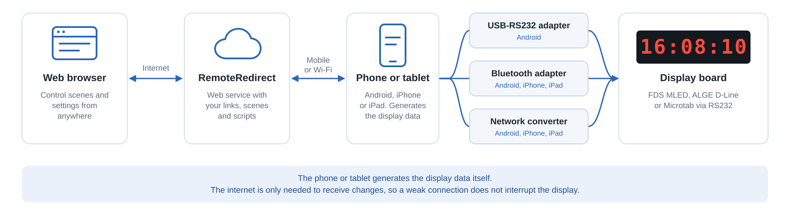

# Bluetooth Adapters

## Overview

The RemoteRedirect app on iPhone, iPad and Android can drive your display board through a Bluetooth Low Energy (BLE) RS232 adapter. The adapter plugs into the display board, and no cable to the phone is needed.


Bluetooth adapters are supported from the next app release after version 1.8.


## Supported Adapters

The following adapter has been confirmed working with our app on iPhone and Android:

* [U.S. Converters S2B5232EV2](https://www.usconverters.com/rs232-serial-bluetooth-5-smart-adapter). The app sets its baud rate for you.

Adapters using one of the following Bluetooth layouts may also work, but they have not been tested:

* Nordic UART
* Microchip Transparent UART
* HM-10 and compatible modules
* FFF0 serial modules

For these adapters, set the baud rate with the adapter's own tool.


Classic Bluetooth (SPP) adapters are not supported. Check that an adapter is Bluetooth Low Energy before you buy it.


## Setup

1. Connect the adapter to the display board and power it on.
2. In the app, tap the serial port icon and choose **Bluetooth serial adapter**.
3. Choose the baud rate of your display board.
4. Tap **No adapter selected**, allow Bluetooth access when asked, and select your adapter from the list. The app connects by itself. Do not pair the adapter in the phone's Bluetooth settings.

To change the baud rate later, tap **Disconnect**, choose the new rate and tap **Connect**.

## Good to Know

* **iPhone and iPad:** keep the app open. The screen stays on while connected and dims after a minute without a touch. Output stops if you leave the app or lock the device.
* **Android:** output continues in the background and with the screen off.
* **Connection:** the app reconnects by itself if the connection drops.
