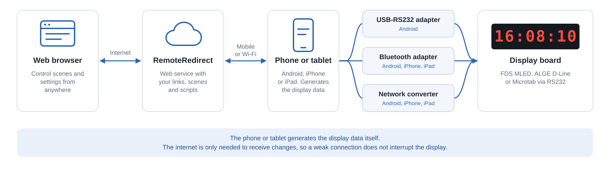

# Android App

## Overview

The Android app establishes a connection to the RemoteRedirect web service and a specific link.

The Android App receives any changes from the RemoteRedirect web service in terms of reference time changes, script changes on scene changes. All the data is sent to the display board is produced locally, and therefore does not need stable internet connection for it. Only when needing to react on changes an internet connection is required.

## USB-RS232 Adapters

The data from the app to the displayboard is usually via RS232. Therefore you need to connect an USB-RS232 adapter to your phone.

The following adapters have been confirmed working with our Android app:

* DriverGenius 1-Port UBS Adapter USB-A ([Amazon](https://www.amazon.de/gp/product/B0BYRW5J4K/ref=ppx_yo_dt_b_asin_title_o02_s00?ie=UTF8\&psc=1))
* DriverGenius 1-Port USB Adapter USB-C ([Amazon](https://www.amazon.de/gp/product/B07Y33RHB2/ref=ppx_yo_dt_b_asin_title_o02_s01?ie=UTF8\&psc=1))

## iOS App

The app is also available for iPhone and iPad. It works the same way, but without USB-RS232 adapters. The display board is reached through a network converter or a [Bluetooth adapter](../../../../app/bluetooth-adapters.md) instead.

## Download

The app can be downloaded from the Google Play Store.


Google Play Store Download


<figure><figcaption></figcaption></figure>

The iOS app can be downloaded from the App Store.


App Store Download

