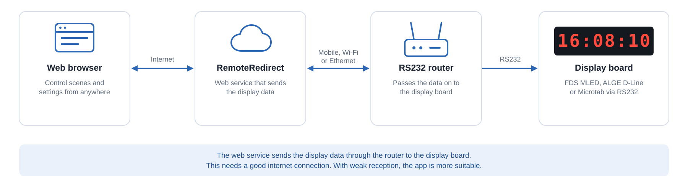

# Mobile RS232-Router

## Overview

The RS232-Router establishes a communication link with the RemoteRedirect web service via the internet (the connection itself depends on the dewvice being used and can range from mobile cell coverage to wireless internet to ethernet internet).

Data is then sent from the RemoteRedirect web service to the router and on via the router's RS232 port to the display board.


In order for the flow of data to be stable, a good internet connection is required.

In case you have bad reception, maybe using the [android-app.md](android-app.md "mention")is more suitable as it will produce the display board content locally and only rely on the internet for changing scenes or scripts.


## Configuration

Configuration for common RS232-routers can be found in the [hardware](../../../../readme/hardware/ "mention")section.
